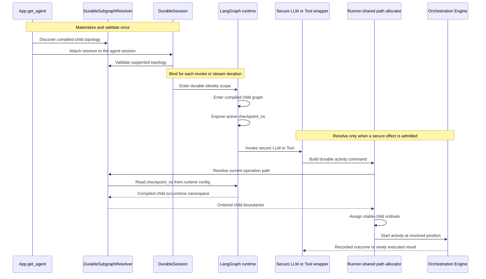

# Durable compiled subgraphs

Atlas Agent Engine supports statically compiled LangGraph child graphs as durable operation
boundaries. The adapter discovers the compiled topology once when the agent is
materialized. Later, when a secure LLM or Tool is admitted, it translates
LangGraph's documented
[`checkpoint_ns`](https://docs.langchain.com/oss/python/langgraph/persistence#checkpoint-namespace)
runtime config into the active compiled-child path. LangGraph also publishes
[`get_config()`](https://reference.langchain.com/python/langgraph/config/get_config)
as the runtime accessor used by the adapter.

The checkpointer persists graph state, but it does not participate in subgraph
identity discovery. There is no producer-side handoff: each secure wrapper reads
the namespace that LangGraph has already placed in its current runtime config.

## End-to-end flow



## Concrete example

Consider this compiled graph:

```text
root graph
  -> case_investigation (compiled child graph)
       -> policy_analysis (compiled child graph)
            -> review_policy (ordinary node)
                 -> secure Tool lookup_policy
```

While `review_policy` runs, LangGraph exposes a namespace with one segment per
active graph task, similar to:

```text
case_investigation:task-a|policy_analysis:task-b|review_policy:task-c
```

[`DurableSubgraphResolver.resolve_namespace`](../src/agent_engine_sdk_langgraph/durable_subgraphs.py)
walks the topology and namespace together:

1. `case_investigation` is a compiled child, so it contributes
   `ChildOperationBoundary("case_investigation", "task-a")`.
2. `policy_analysis` is a compiled child inside it, so it contributes
   `ChildOperationBoundary("policy_analysis", "task-b")`.
3. `review_policy` is an ordinary node. It is validated as the rightmost
   namespace segment and does not contribute a child boundary.

Runner-shared uses each occurrence key to assign an ordinal under its parent:

```text
agent/1 / case_investigation/1 / policy_analysis/1
```

The `task-a` and `task-b` strings come directly from the text after `:` in
LangGraph's namespace. Atlas Agent Engine treats them as opaque allocator keys. The final
operation path contains stable ordinals rather than LangGraph's raw task IDs.

The secure LLM and every secure Tool reached from `review_policy` resolve the
same compiled-child prefix. Their activity kind, workflow step, and activity
ordinal then distinguish the individual effects beneath that prefix.

## Discover the static topology

[`App.get_agent`](../src/agent_engine_sdk_langgraph/runtime.py) creates a
`DurableSubgraphResolver` when the materialized graph uses the platform
checkpointer. The resolver recursively inspects `CompiledStateGraph` nodes and
stores only:

- every node name at each graph level, for namespace validation; and
- each directly compiled child graph, for operation boundaries.

[`DurableSession`](../src/agent_engine_sdk_langgraph/durable_session.py) validates the
saved topology before durable execution begins. Cyclic compiled topology and a
compiled child with its own checkpointer fail explicitly. A supported child uses
`checkpointer=None` and inherits the root platform checkpointer.

Discovery does not assign activity identities and does not persist runtime task
IDs. It records the structural map needed to interpret LangGraph's active
namespace later.

## Bind the resolver to execution

Invoke and stream execution bind the same resolver, together with the run's
`SendTaskRecorder` (see [Send workers](#send-workers)), through
`DurableSubgraphResolver.scope`:

- [`ExecutionSession.invoke_scopes`](../src/agent_engine_sdk_langgraph/execution_session.py)
  covers a complete `invoke` call.
- [`scoped_anext`](../src/agent_engine_sdk_langgraph/stream_scope.py) rebinds the scope
  for each stream iteration because an async generator may resume in a different
  asyncio task.

The scope installs the resolver through agent-engine-runner-shared's
[`operation_path_resolver_scope`](../../agent-engine-runner-shared/src/agent_engine_runner_shared/workflow/context.py).
This is the adapter boundary: agent-engine-runner-shared knows only that a callback can
return ordered child boundaries; it does not know LangGraph namespaces or graph
types.

## Resolve at the secure effect boundary

Secure LLM and Tool wrappers eventually call
[`run_serial_activity`](../../agent-engine-runner-shared/src/agent_engine_runner_shared/workflow/activity.py)
to build an OE activity. During command construction,
[`current_operation_path`](../../agent-engine-runner-shared/src/agent_engine_runner_shared/workflow/context.py)
invokes the scoped `DurableSubgraphResolver`.

The resolver then:

1. Calls LangGraph's public `get_config()` while the node is active.
2. Reads `configurable.checkpoint_ns`.
3. Parses each `name:occurrence-key` segment from left to right.
4. Requires every segment to match the topology discovered at construction.
5. Returns a boundary for each compiled child and omits the final ordinary node.

An ordinary node may appear only as the rightmost segment. A namespace that
continues beneath an ordinary node cannot be explained by the compiled topology
and is rejected. This prevents an unfamiliar framework path from silently
collapsing onto a valid durable identity.

A graph without compiled children skips namespace parsing: its effects stay on
the root path unless they run in a `Send` worker.

Runner-shared combines the returned boundaries with the fixed `agent/1` root,
the current workflow step, and the effect's activity ordinal. That complete
position is what OE uses for record or replay.

## Replay

On replacement, LangGraph enters the same compiled-child occurrence and exposes
the corresponding namespace. The adapter reconstructs the same ordered child
boundaries, agent-engine-runner-shared assigns the same ordinals, and the secure effect asks
OE for the same activity position. OE returns the recorded outcome instead of
executing the external effect again.

Only secure LLM and Tool wrappers trigger this resolution. Ordinary graph work
can move through compiled children without creating OE activities.

## Send workers

LangGraph runs every [`Send`](https://docs.langchain.com/oss/python/langgraph/graph-api#send)
worker of a superstep concurrently, so arrival order cannot identify a worker's
effects. Each worker instead gets its own operation-path segment,
`langgraph.task:__pregel_push:<step>:<index>`. The step is the LangGraph
superstep that runs the worker (`langgraph_step`), which keeps successive
`Send` rounds of one graph run apart; the index is the worker's position in
that superstep's send list.

Both numbers are stable across attempts. Every attempt seeds its scratch
thread from the same committed state, so LangGraph counts supersteps from the
same start, the producer emits the same sends, and LangGraph applies each
superstep's writes in task-path order, so the send list has the same order. The
Pregel task ID and the namespace's occurrence key are derived from the
attempt's checkpoint ID and change on every attempt.

The resolver finds the worker's step and index in two places:

- **The running node is the worker.** LangGraph's run metadata
  (`langgraph_path`) is `("__pregel_push", <index>, ...)`, and the resolver
  appends the worker's segment.
- **The worker is a compiled child.** Inside the child, the metadata describes
  only the child's own node and the namespace names the worker by its runtime
  task ID. `SendTaskRecorder`, a LangChain callback registered for the
  duration of the run, records each `Send` task's namespace segment and index
  when the task starts. The resolver places the worker's segment before that
  child's boundary.

```text
agent/1 / langgraph.task:__pregel_push:1:0 / research/1   <- first worker's child
agent/1 / langgraph.task:__pregel_push:1:1 / research/1   <- second worker's child
```

A Tool that a worker's model requested keeps the position its model reserved,
even when it executes in another task (see
[Durable activity identity](durable-activity-identity.md)).

Graphs created by `app.deep_agent()` keep their existing paths: LangChain's
agent factory routes each ToolCall through an internal `Send`, and Deep Agent's
recorded activities predate these segments.

## Supported boundary

Durable compiled-subgraph identity supports statically materialized child
graphs that inherit the root platform checkpointer, and `Send` workers sent from
any graph level. Plain nodes that run in parallel on fixed edges share their
parent's path and take activity ordinals in arrival order, so a replacement
attempt can reject them as nondeterministic; put model calls in such branches
inside compiled children. A `Send` worker that runs its own graph from node
code is supported only in a graph without compiled children. A graph run from
node code adds its own namespace segment, so in a graph with compiled children
it is outside the compiled topology and its first activity is rejected.

## Call-site map

| Responsibility | Call site |
| --- | --- |
| Materialize the graph and create the resolver | [`runtime.py`](../src/agent_engine_sdk_langgraph/runtime.py) |
| Discover and translate compiled topology | [`durable_subgraphs.py`](../src/agent_engine_sdk_langgraph/durable_subgraphs.py) |
| Validate the topology before durable execution | [`durable_session.py`](../src/agent_engine_sdk_langgraph/durable_session.py) |
| Record `Send` worker indexes | [`durable_subgraphs.py`](../src/agent_engine_sdk_langgraph/durable_subgraphs.py) |
| Bind identity during `invoke` | [`execution_session.py`](../src/agent_engine_sdk_langgraph/execution_session.py) |
| Bind identity during each stream iteration | [`stream_scope.py`](../src/agent_engine_sdk_langgraph/stream_scope.py) |
| Convert child boundaries into an operation path | [`context.py`](../../agent-engine-runner-shared/src/agent_engine_runner_shared/workflow/context.py) |
| Admit secure LLM effects | [`secure_llm_proxy.py`](../../agent-engine-runner-shared/src/agent_engine_runner_shared/secure_llm_proxy.py) |
| Admit secure Tool effects | [`secure_wrapper.py`](../../agent-engine-runner-shared/src/agent_engine_runner_shared/secure_wrapper.py) |
| Build and start the OE activity | [`activity.py`](../../agent-engine-runner-shared/src/agent_engine_runner_shared/workflow/activity.py) |

## Verification and maintenance

When upgrading LangGraph:

1. Revalidate the public `checkpoint_ns` and `get_config()` contracts linked
   above.
2. Run topology, namespace parsing, invalid-shape, and invocation-scope scenarios
   in [`test_durable_subgraphs.py`](../tests/test_durable_subgraphs.py).
3. Run compiled-child replay, sibling identity, and `Send` worker scenarios in
   [`test_durable_subgraphs_integration.py`](../tests/test_durable_subgraphs_integration.py).
   They depend on LangGraph's `langgraph_path`, `langgraph_step`, and
   `langgraph_checkpoint_ns` run metadata and on task-path-ordered `Send` writes.
4. Run invoke and stream coverage in
   [`test_agent.py`](../tests/test_agent.py).
